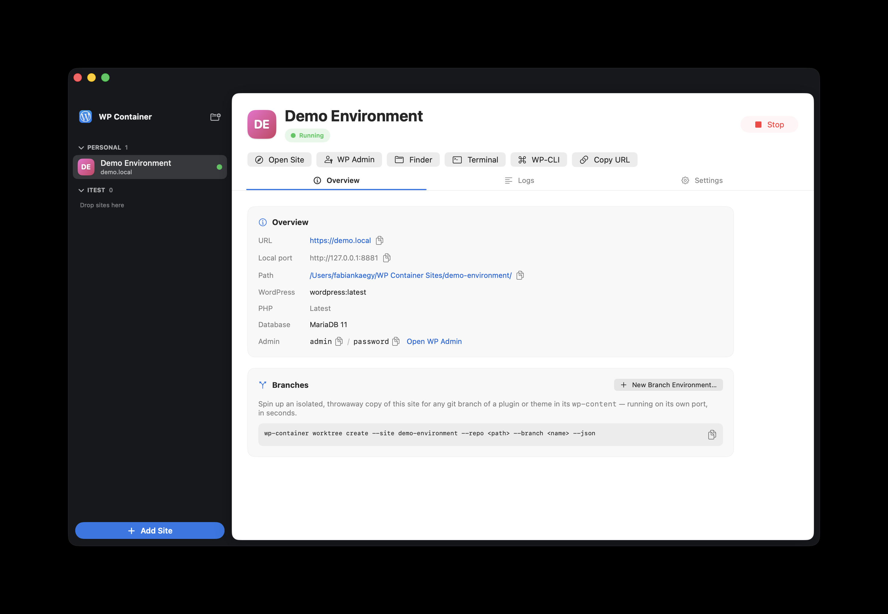
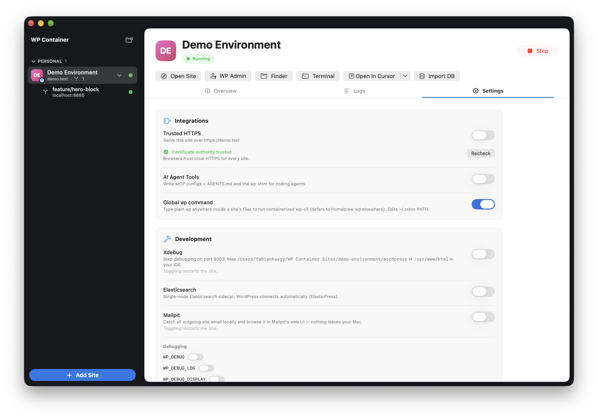
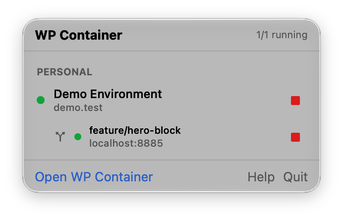

<p align="center">
  
</p>

<h1 align="center">WP Container</h1>

<p align="center">
  Local WordPress development on macOS, built on Apple's native
  <a href="https://github.com/apple/container">container</a> runtime.<br>
  A SwiftUI app, CLI, and MCP server for running sites and isolated git branch environments,
  with the whole WordPress install in a plain folder you own.
</p>

---

## What it does

WP Container creates and manages local WordPress sites, each running in lightweight
Apple `container` VMs (WordPress + MariaDB per site). Every site's **full WordPress
installation lives in a normal folder on your Mac** — drop your git-managed
`wp-content` plugin or theme repos straight in and they're live immediately.

```
~/WP Container Sites/my-blog/
├── wordpress/        ← the entire WP install, host-visible (mounted to /var/www/html)
│   └── wp-content/   ← your git repos go here
├── database/         ← MariaDB data, survives restarts (also serves the
│                       branch environments' schemas)
└── wp                ← per-site wp-cli shim
```

Sites are provisioned automatically (no install wizard) and log in with
`admin` / `password`.

<p align="center">
  
</p>

<p align="center">
  
</p>

<p align="center">
  
</p>

## Highlights

- **One-click sites** — create, start, stop, delete from a Studio-style UI; sidebar
  with live status, per-site overview, streaming container logs.
- **Branch environments (git worktrees)** — spin up an isolated, fully-running clone
  of a site for any branch of a repo inside `wp-content`, in ~5 seconds (APFS
  copy-on-write + a bind mount that shadows the repo path with the worktree
  checkout). The parent site keeps running untouched. An env's database is its
  own schema on the parent site's existing MariaDB container, so it runs **one**
  container instead of two — see
  [Shared databases](#branch-environments-share-the-parents-database). Built for
  AI agents:
  ```bash
  wp-container worktree create --site my-blog \
    --repo wp-content/plugins/my-plugin --branch feature-x --json
  # → {"url": "http://my-blog-wt-feature-x.localhost",
  #    "localUrl": "http://127.0.0.1:8882", "path": …, "worktreePath": …}
  ```
- **`wp-container` CLI** — everything the app does, scriptable, with `--json`
  everywhere: `list`, `create` (`--wp/--php/--multisite/--domain/--group`),
  `start`, `stop`, `delete`, `worktree …`, `wp …` (wp-cli proxy), `xdebug`,
  `elasticsearch`, `domain`, `https`, `resolve-site`, `setup wp`. Install with
  `make install-cli` (adds a `wpc` shortcut + the global `wp` router binary).
- **Ephemeral containers, durable sites** — containers are disposable (`--rm`);
  all state lives in the site folder. Sites survive app restarts and reconcile
  against real container state via labels.
- **Studio-style dark-frame UI** — dark window shell with a light inset content
  panel, Overview / Logs / Settings tabs, collapsible **site groups** with
  drag & drop, and a **menu bar extra** for one-glance status and start/stop of
  every site. Sites with a favicon or WordPress Site Icon show it as their
  avatar; sidebar rows get right-click quick actions and a clickable
  start/stop status dot.
- **Menu-bar-first option** — app settings (⌘,) cover hiding the Dock icon,
  launch at login, default sites folder and WP×PHP versions, HTTPS-proxy
  autostart, and notifications. Native macOS notifications fire for background
  start/stops, site creation, branch environments coming up (click to open),
  core updates, and proxy failures.

- **Xdebug & Elasticsearch** — per-site one-click toggles in Settings → Development.
  Xdebug builds a derived image once per base tag and points `client_host` at the
  host gateway (port 9003); Elasticsearch runs a single-node sidecar wired into
  WordPress (ElasticPress-ready). Recipes validated in `scripts/validate-addons.sh`.
- **Custom domains** — give a site `mysite.local`; a managed `/etc/hosts` block plus
  the host proxy route it (HTTP and HTTPS), the local cert re-issues to cover it,
  and WordPress URLs update automatically.
- **Multisite** — create subdirectory or subdomain networks from the setup guide
  (`wp core multisite-install` + MULTISITE constants + network `.htaccess`); the
  Overview tab lists network subsites.
- **WP × PHP versions** — the new-site flow is a 3-step guide (name → WordPress ×
  PHP version with a live image-tag preview → options); change PHP later (image
  swap + restart) or update core from Settings → Software.
- **MCP agent tools** — `wp-container agent-tools enable <site> [--root …]` writes
  `.mcp.json` (+ Cursor/VS Code configs) and a marked `AGENTS.md` block into a
  chosen root (site folder, or your `wp-content` repo root for IDE discovery);
  the bundled MCP stdio server (`wp-container mcp --site <slug>`) exposes 18 tools
  in the spirit of [10up/localwp-agent-tools](https://github.com/10up/localwp-agent-tools):
  `wp_cli`, log readers, `wp-config` editing, site info/health, start/stop/status,
  `list_sites`, `worktree_*`, `xdebug_toggle` / `elasticsearch_toggle`, plus
  `login_link` / `create_user`.
- **Agent-friendly login** — `wp-container login <site>` prints a one-time magic
  login link (single-use, 15-minute expiry) that opens straight into a logged-in
  wp-admin — no `wp-login.php` form for agents to fumble. `--open` opens it, and
  the `login_link` / `create_user` MCP tools expose the same for agents.
- **Zero project-tree footprint** — all runtime PHP WP Container manages (magic
  login, Mailpit mail routing, remote-media rewriting) loads via a single
  `auto_prepend_file` in each site's private `php/` folder, never as a mu-plugin
  under `wp-content/`, so nothing can be committed to your repo by accident.
- **Trusted HTTPS** — mkcert-style local CA trusted per-user in the login keychain
  (**no admin password — Touch ID supported**); `https://<site>.localhost` (or your
  custom domain) served by a host-side TLS reverse proxy (443, Host-header routing).
- **wp-cli everywhere** — `wp-container wp <site> -- …`; a `./wp` shim in every site
  that maps your current subdirectory into the container; an optional global `wp`
  router (`wp-container setup wp`) so plain `wp` inside a site runs containerized
  wp-cli and defers to Homebrew's `wp` elsewhere; an interactive WP-CLI Terminal
  button; and the MCP `wp_cli` tool.
- **Dev-ready by default** — every site gets `WP_DEVELOPMENT_MODE=all` /
  `WP_ENVIRONMENT_TYPE=local`, with live `WP_DEBUG`-family switches in
  Settings → Development.
- **Mailpit email catching** — per-site toggle; all outgoing mail lands in a
  local mailbox (`https://<site>-mail.localhost`, plus a REST API agents can
  read). Persistent across restarts.
- **Per-site resource limits** — cap CPU/memory per site in
  Settings → Resources or `wp-container limits <slug> --cpus 2 --memory 512`
  (see [docs/RESOURCES.md](docs/RESOURCES.md)).
- **Auto-stop idle, wake on request** — a branch environment nobody has used for
  3 hours is stopped and its ~500 MB returned to macOS; the next request to its
  URL starts it again behind a "waking up" page that refreshes into the live site.
  A freshly created environment still on that default gets a further 6-hour
  grace period during which it is never auto-stopped regardless of use — an
  explicit timeout (`wp-container idle <env> --minutes N`) always wins over
  the grace period, exactly like it wins over the default itself. On by
  default for environments, opt-in for sites. `wp-container idle <slug>`, the
  Idle stop card, or the `set_idle_stop` MCP tool — see
  [docs/RESOURCES.md](docs/RESOURCES.md).
- **Touch ID for privileged actions** — the optional signed hosts-helper
  makes custom-domain changes a Touch ID dialog instead of a password prompt
  (one-time enable in Settings → General).

## Requirements

- macOS 26 (Apple Silicon)
- [Apple `container`](https://github.com/apple/container) ≥ 1.1.0 (`brew install container`
  or the release installer); the app offers to start its system service
- Xcode 26+ and [XcodeGen](https://github.com/yonaskolb/XcodeGen) to build from source

## Building

```bash
git clone https://github.com/fabiankaegy/wp-container.git
cd wp-container
make build            # xcodegen + xcodebuild (app + CLI)
open build/Build/Products/Debug/WPContainer.app
make install-cli      # optional: /usr/local/bin/wp-container + wpc
```

## How it works

Each site runs two containers (`wpc-<slug>-wp`, `wpc-<slug>-db`) labeled
`dev.wpcontainer.site=<slug>`, with the site folder bind-mounted in. The app and
CLI share one store (`~/Library/Application Support/WPContainer/sites.json`) with
file locking, and treat container labels as ground truth. Notable Apple-container
specifics we handle for you (all empirically verified — see
`scripts/validate-container-workflow.sh`): WordPress core is pre-seeded because
virtiofs mounts reject `chown`, MariaDB runs as its own uid, and the DB's IP is
re-discovered on every start.

Each container runs in its own lightweight VM — memory/CPU defaults, real
measured usage, and the limitations to be aware of are documented in
[docs/RESOURCES.md](docs/RESOURCES.md). Short version: caps aren't
reservations, stopped sites cost zero, and stopping unused sites is the lever
that matters — which is why the proxy now does it for you (below).

### Idle environments can stop themselves and wake on request

Apple `container` never returns guest memory to macOS, so a running VM's host
footprint is its high-water mark and only stopping it reclaims anything. VM boot
is ~1s, which makes that trade cheap: the reverse proxy tracks when each site and
environment was last used, stops the ones past their timeout, and starts them
again on the next request while serving a page that auto-refreshes into the live
site.

- **Environments: on by default (3 hours), with a 6-hour grace period after
  creation. Sites: off by default.** The difference between envs and sites is
  observability, not importance. An environment's container
  publishes no host port — the proxy serves its `<env>.localhost` domain (the URL
  every surface advertises, and that WordPress has as `home`/`siteurl`) and binds
  `127.0.0.1:<env port>` itself, relaying both to the container — so every way
  into an environment runs through the proxy. Every request
  to an environment therefore counts as use, and reopening a parked one wakes it
  **at that same URL**. A *site* still publishes its own port, and a request
  straight to `http://127.0.0.1:<port>` bypasses the proxy — that's the one
  remaining blind spot, and why sites stay opt-in.
- **What else counts as use:** wp-cli, MCP tool calls, magic-login links and
  explicit starts, recorded as a persisted stamp so they work across processes.
  Full table in [docs/RESOURCES.md](docs/RESOURCES.md).
- A site is never auto-stopped while any of its environments are running, and
  stopping an environment also retires the parent's shared MariaDB container once
  nothing else needs it — that's the other ~470 MB.
- Configure per instance: the **Idle stop** card on a site's Settings tab or an
  environment's detail pane,
  `wp-container idle <slug> [--minutes N | --off | --default]`, or the
  `set_idle_stop` MCP tool so an agent can opt its own environment out while it's
  mid-task and back in when it's done.
- Enforcement — and, for environments, reachability — lives in whichever process
  owns the proxy: the app, or `wp-container proxy serve`. The app starts it
  automatically when an environment starts; the CLI and MCP warn when nothing is
  listening (the environment still starts; wp-cli and MCP need no HTTP).

### Branch environments share the parent's database

A branch environment does **not** run a MariaDB container of its own. It gets its
own schema (`wpc_<env-slug>`) on the parent site's existing server, cloned from
the parent's data at creation time. That halves the container count per env —
2 VMs → 1 — and since a MariaDB VM costs ~470 MB of real memory regardless of how
much data it holds, the marginal cost of env #5 or #10 is close to zero.

Practical consequences:

- An env's database is only available while the parent's `wpc-<site>-db`
  container is running. Starting an env starts that container if it isn't up;
  stopping the last running env of a stopped site shuts it down again. Stopping or
  deleting an env never touches the parent's database container itself.
- Deleting an env drops exactly its own `wpc_*` schema. If the server happens to
  be down at that moment, the name is recorded on the parent site and dropped the
  next time an env is created for it. Only names recorded that way are ever
  dropped — never "every `wpc_*` schema the store doesn't recognise", which would
  race an environment being created alongside it and destroy a live database.
- The env's WordPress finds its schema through `WORDPRESS_DB_NAME`, so nothing on
  disk is edited. If a project ships its own `wp-config.php` with a hardcoded
  `define('DB_NAME', …)` the env would silently write into the parent's database —
  so creation detects that and falls back to a dedicated container, with a
  warning saying so.

Pass `--isolated-db` (CLI), `isolated_db: true` (MCP), or switch on **Isolated
database** in the New Branch Environment sheet to opt out and get a dedicated
container. It's worth it for a genuinely large database: an isolated env off a
*stopped* parent copy-on-write-clones the `database/` folder, which is instant at
any size, whereas the shared path is always a logical dump and restore.

## Development

- `PLAN.md` — full architecture and product spec.
- `scripts/validate-container-workflow.sh` — end-to-end proof of the container
  recipe (site lifecycle, persistence, worktree cloning).
- `scripts/validate-addons.sh` — Xdebug image build + Elasticsearch validation.
- Targets: `WPContainerKit` (models + services), `WPContainer` (SwiftUI app),
  `wp-container` (CLI). Swift 6 strict concurrency throughout.

## License

WP Container is released under the [MIT License](LICENSE). The open-source
packages it links are listed, with their licenses, in
[THIRD_PARTY_NOTICES.txt](THIRD_PARTY_NOTICES.txt).

WordPress is a trademark of the WordPress Foundation. WP Container is not
affiliated with or endorsed by the WordPress Foundation or Automattic.
